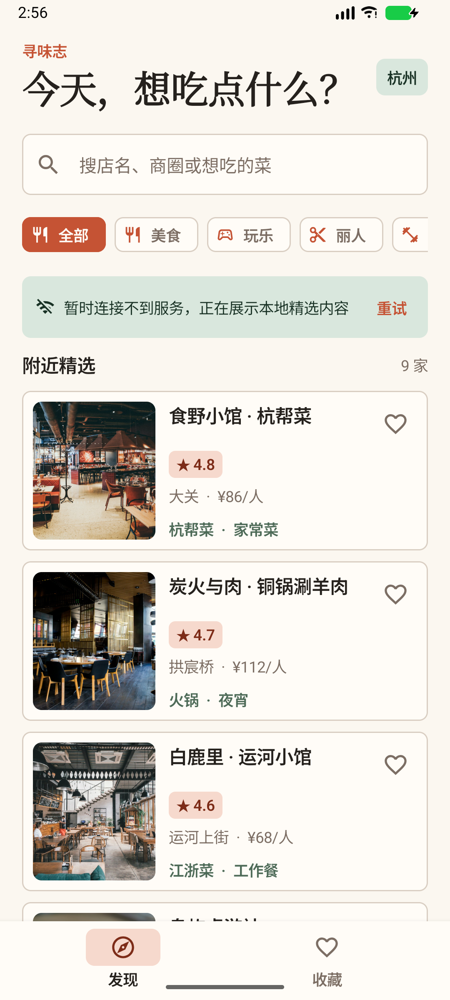
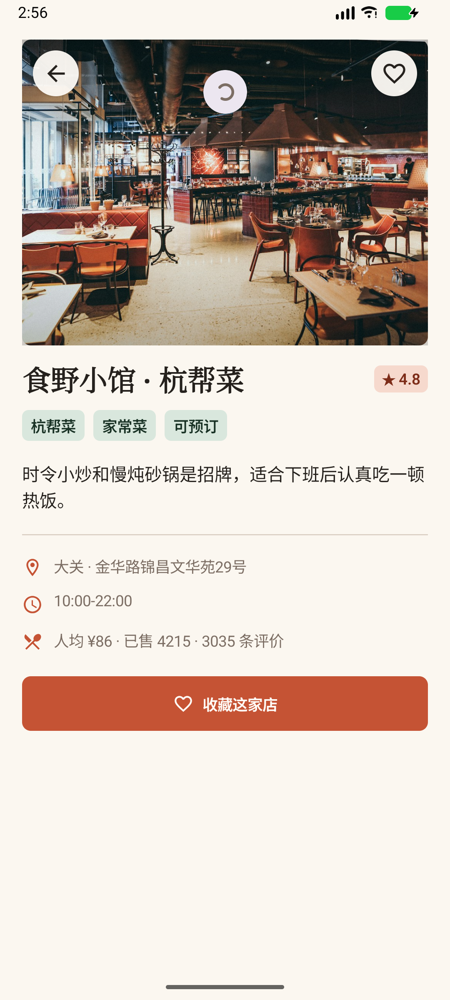
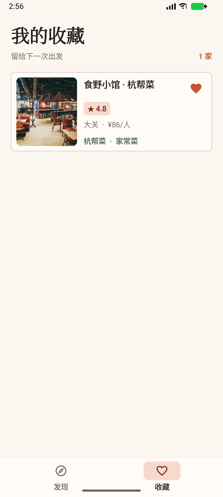
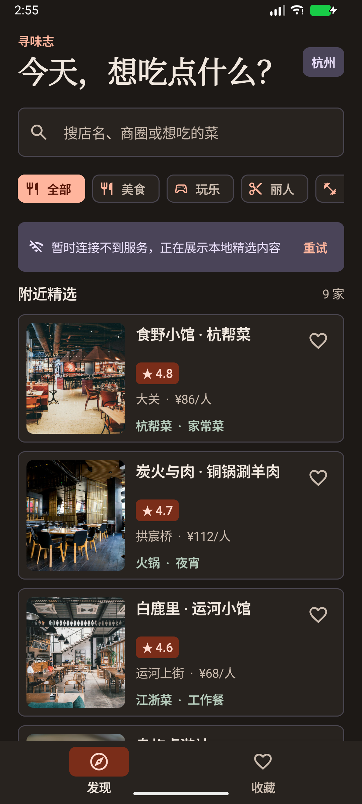

# 寻味志 Android

一个使用 Kotlin 和 Jetpack Compose 实现的本地生活店铺客户端。项目复用 `hm-dianping` 后端的公开店铺接口，同时内置离线示例数据，未启动后端时也可以完整演示。

## 功能

- 店铺列表、分类筛选和关键词搜索
- 店铺详情、地址、营业时间、评分和人均消费
- 下拉刷新、加载、空数据、失败提示和重试
- Room 本地缓存与收藏持久化
- 收藏列表与收藏状态双向同步
- Retrofit 接入真实后端，连接失败时自动展示本地精选内容
- 明暗主题和边到边布局

## 截图

| 店铺列表 | 店铺详情 | 我的收藏 |
| --- | --- | --- |
|  |  |  |

<p>
  
</p>

## 技术栈

- Kotlin
- Jetpack Compose + Material 3
- ViewModel + StateFlow
- Navigation Compose
- Retrofit + OkHttp + Gson
- Room
- Coil
- Coroutines

## 架构

```text
ui/
  shoplist/      列表页面、筛选、搜索和刷新状态
  detail/        详情页面
  favorites/     收藏页面
  components/    通用店铺卡片和图片组件
data/
  remote/        Retrofit API 和网络模型
  local/         Room Entity、DAO、Database
  repository/    缓存优先的数据仓库和离线示例数据
domain/          页面使用的领域模型
```

界面只依赖 ViewModel 暴露的 `StateFlow`，ViewModel 通过 Repository 读写网络和 Room。列表始终从 Room 观察数据，网络刷新成功后覆盖本地缓存，因此旋转屏幕或断网后仍能展示已有内容。

## 运行

1. 使用 Android Studio 打开本目录。
2. 等待 Gradle 同步完成。
3. 连接模拟器或真机，运行 `app`。

默认后端地址在 [app/build.gradle.kts](app/build.gradle.kts) 中：

```kotlin
buildConfigField("String", "API_BASE_URL", "\"http://10.0.2.2:8081/\"")
```

`10.0.2.2` 是 Android 模拟器访问宿主机的地址。连接真机时请改为电脑在局域网中的 IP。后端未启动时，应用会自动使用 `DemoShops` 中的本地数据。

## 验证

```powershell
.\gradlew.bat :app:assembleDebug
.\gradlew.bat :app:testDebugUnitTest
```

Debug APK 输出位置：

```text
app/build/outputs/apk/debug/app-debug.apk
```
